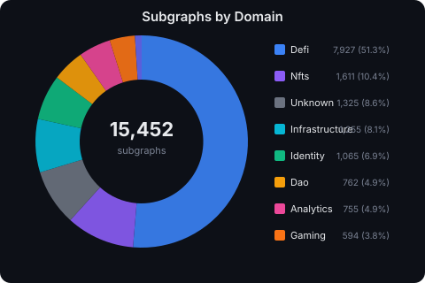
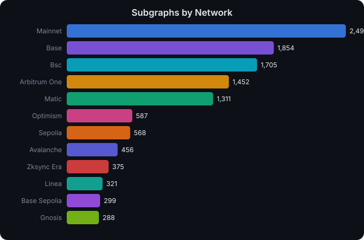
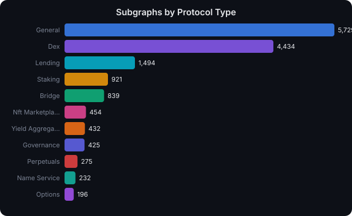
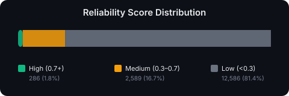

# Subgraph Registry

<a href="https://glama.ai/mcp/servers/PaulieB14/subgraph-registry">
  
</a>

Agent-friendly semantic classification of all subgraphs on [The Graph Network](https://thegraph.com).

Pre-computed index of **15,452 subgraphs** with domain classification, protocol type detection, schema fingerprinting, canonical entity mapping, and composite reliability scoring.

> **What's new in 0.8.0** — three agent-discovery upgrades:
> - **[Semantic search](#semantic-search)** via 384-dim embeddings (`semantic_search_subgraphs`)
> - **[Schema evolution tracking](#schema-evolution)** with stability days surfaced on every result (`get_schema_changes`)
> - **[OpenAPI 3.1 spec](#openapi)** auto-generated for MCP tools + REST routes, served at `/.well-known/openapi.json`

## Publishing a reviewed release

See [the publish-only release guide](docs/RELEASING.md) for main-only manual npm/ClawHub publication using repository secrets, without a crawl, data rebuild, or main-branch write.

## The Problem

Agents querying The Graph need to discover and select the right subgraph before they can query data. Today this requires 3-4 tool calls (search, check volumes, fetch schema, infer structure) before any real work happens. This registry flips that: agents start with structured knowledge, not a blank slate.

## What It Does

1. **Crawls** all active subgraphs from the Graph Network meta-subgraph
2. **Fetches** the GraphQL schema for every deployment
3. **Extracts contract addresses** from each manifest's `dataSources` and `templates` — agents can answer "which subgraph indexes contract 0x… on chain X?"
4. **Generates a per-subgraph starter GraphQL query** from the parsed schema (real top entity, real fields, sensible orderBy) — no more generic boilerplate that doesn't compile against most subgraphs
5. **Classifies** each subgraph by domain, protocol type, canonical entities, and schema family
6. **Scores** reliability using on-chain signals (query fees, volume, curation, stake)
7. **Returns x402 + legacy query URLs** — agents can pay $0.01 USDC on Base per query (no API key) or use a Studio key
8. **Publishes** as SQLite database + REST API + MCP server + **per-subgraph JSON-LD at `/.well-known/subgraph/{id}.jsonld`** for ecosystem crawlers
9. **Generates** visual dashboards and bot-readable category files (auto-updated with each sync)

---

## Contract lookup, measured freshness, and goal-to-starter workflow

The **Node MCP server** (stdio and SSE) now exposes three complementary tools.
Existing search/recommend/detail calls remain discovery-only; they never probe or
execute. No crawler/database migration or Python API change is required.

### `find_by_contract(address, chain?, limit=3)`

```js
await mcp.call("find_by_contract", {
  address: "0x1F98431c8aD98523631AE4a59f267346ea31F984",
  chain: "ethereum", // normalized to mainnet; omit to search all networks
  limit: 3,         // integer 1–20
});
```

Matches exact, case-insensitive EVM addresses from crawled manifests, checking
**each manifest record's network** (falling back to the deployment network).
Ranks allocated, non-denied snapshot deployments by reliability then 30-day
volume; de-duplicates before limiting. `get_top_subgraph_deployments` keeps its
existing `(contract_address, chain)` interface and uses the same implementation.

Results include matched manifest records, starters, and `schema_entities` for the
**whole deployment**. Current registry data does not map a contract to particular
entities/fields, so `coverage.contract_to_entity_mapping` is explicitly null.
Dynamic template instances and substreams may be missing. No match is not proof
that no subgraph indexes the contract; allocation/reliability remain snapshot signals.

### `check_subgraph_health(id | subgraph_id | ipfs_hash | deployment_id)`

Explicitly opts into **one** Studio-key gateway request for:

```graphql
{ _meta { deployment hasIndexingErrors block { number timestamp } } }
```

Known subgraph IDs are pinned to the crawled deployment. Returns `freshness.live`
with measured `observed_at` (Unix seconds), indexed block/timestamp, indexing-error
flag, HTTP status, and one of `serving`, `indexing_errors`, `metadata_unavailable`,
or `query_failed`. A successful metadata query **does not prove chain-head sync**;
`synced_to_chain_head` remains null. Unsupported metadata is unknown, not fabricated.

Search, recommendation, detail, contract results, and JSON-LD manifests expose
cached freshness without making calls. Before a probe, `live` is null. Observations
are process-local (maximum 500), become `stale: true` after 300 seconds, and disappear
on restart. There is no background check or new reliability-score interpretation.
`registry_updated_at` is the upstream metadata update, **not** a crawl/health timestamp.
This credential-only tool is not advertised on keyless servers.

### `query_for_goal(goal, chain?, first=5, execute=false)`

```js
// Local preparation only — also safe when the server has a Studio key.
const prepared = await mcp.call("query_for_goal", {
  goal: "uniswap v3 on ethereum", first: 3,
});

// Only when data fetching is wanted: one opt-in gateway POST.
const fetched = await mcp.call("query_for_goal", {
  goal: "uniswap v3 on ethereum", first: 3, execute: true,
});
```

Uses existing recommendation ranking, skips missing/unsafe starters among the top
five candidates, and selects the first suitable one. The returned `selected`,
`query`, request payload (keyed and x402 URLs), validation status, and cached
freshness allow one-call preparation or optional first-page execution. Requests
pin the crawled deployment where available. **The starter is an example, not an
arbitrary natural-language query generator**: inspect whether it answers the goal.

GraphQL syntax is parsed; a conservative structural check permits one collection,
1–10 rows, at most ten flat fields, optional standard `_meta`, and ordering only.
Mutations, variables, aliases, fragments, directives and nested selections are
rejected. This is **not live schema validation** (`validation.live_schema` always
says `not_checked`). Gateway execution success/failure is reported separately;
GraphQL/auth errors (even HTTP 200), partial data, malformed responses and transport
failures never become a success claim. `execution_attempted` records a gateway
attempt; `executed` is true only for a successful gateway result, not on a timeout. There are no execution retries or automatic
fallback queries. The existing timeout/response-size limits apply, and gateway
redirects are rejected.

`execute` defaults to false. Execution and health require an explicitly invoked
path **and** `THE_GRAPH_STUDIO_API_KEY` (existing key aliases still work). Keyless
execution returns `credentials_required`, `executed: false` and an unsigned request
payload. These tools never sign/pay x402 and accept no arbitrary endpoint URL.

---

## Agent usability and discovery diagnostics

The canonical shareable agent guide is [SKILL.md](SKILL.md): pinned installation,
capability discovery, chain/protocol lookup, human-assisted Studio key setup,
bounded preparation, opt-in execution and error handling. See the reproducible
[discovery audit](docs/DISCOVERY_AUDIT.md) for published-package versus connected
runtime results and which changes here are not released yet.

Search recognizes a standalone known chain/alias (for example `query:"arc"`) as
a network filter and returns `inferred_network`; an explicit `network` always
wins. Use `network:"arc"` for mainnet and `network:"arc-testnet"` for testnet.
Empty searches explain matching snapshot records and overlapping exclusions in
`diagnostics`. Default allocation/denied/testnet filters remain unchanged;
`include_unserved:true` deliberately includes zero-allocation records for discovery.

**Rewards, curation and queryability are not interchangeable.** A chain can be
live and queried before rewards or curation signaling is enabled. Zero
allocations is not proof of unavailable queries, and positive allocations is not
a live health check. Reward denial is not proof of spam or query failure.
Reliability is a traction-weighted ranking input, not a measured uptime or
reward-eligibility score. Unknown health remains unknown; no discovery probe is
performed. The published-network corpus cannot include all Studio-only deployments.

Search/recommend/goal responses provide a structured `next_action`: reuse a
configured key (not assumed valid), or have a human create one at
[Studio API Keys](https://thegraph.com/studio/apikeys/), then store it in the MCP
host's secret manager as `THE_GRAPH_STUDIO_API_KEY`. Never paste it in chat or
logs. [Official Studio pricing](https://thegraph.com/studio-pricing/) currently
advertises **100,000 free monthly queries**; check the account's remaining quota
and plan, not a fictitious per-key allowance. Studio development endpoints have
separate limits. These hints never create a key, execute GraphQL, or auto-pay.

Search `limit` is an integer 1–100 (semantic: 1–50); booleans must be JSON
booleans. Unsupported offset/cursor arguments are rejected, not silently ignored.
`total` remains the number returned, not a total-match or pagination promise.

## Querying with x402 (no API key)

Every result includes `query_url_x402` alongside the legacy `query_url`. The Graph's public x402 gateway (live since 2026-05-08) accepts **$0.01 USDC on Base** per query with zero signup.

**Financial capability warning:** this optional external client signs a USDC
payment authorization and may retry automatically. It is not the registry server.
Use it only after explicit owner approval of the payment/amount and review of
the signing client and query. Never fall back to payment on auth/quota failure.
The example is disabled by default; the keyed Studio route above needs no wallet.

```js
// Requires a separately configured, reviewed external x402 client.
const ownerApprovedPaidQuery = false; // set only after explicit payment approval
if (!ownerApprovedPaidQuery) throw new Error("Payment approval required");
// An x402-native agent — discovery to data in two calls
const { recommendations } = await mcp.call("recommend_subgraph", {
  goal: "find DEX trades on Arbitrum",
});
const top = recommendations[0];
if (!top?.example_query) throw new Error("No starter; inspect schema first");
// Inspect the starter against schema and goal before signing any payment.

// POST your GraphQL query. The first call returns HTTP 402 with a
// base64 `payment-required` header; the x402 client signs the
// EIP-3009 USDC transfer on Base and retries automatically.
const data = await x402Fetch(top.query_url_x402, {
  method: "POST",
  body: JSON.stringify({ query: top.example_query }),
});
```

Pricing manifest returned per subgraph:

```json
{
  "amount_usd": 0.01,
  "asset": "USDC",
  "asset_contract": "0x833589fCD6eDb6E08f4c7C32D4f71b54bdA02913",
  "chain": "base",
  "network": "eip155:8453",
  "pay_to": "0x79DC34E41B2b591078d3dE222C43EcaaBD52FcCB",
  "scheme": "exact",
  "asset_transfer_method": "eip3009"
}
```

Client libraries: [`@graphprotocol/client-x402`](https://www.npmjs.com/package/@graphprotocol/client-x402), `x402-fetch`, or any generic x402 wrapper.

---

## Registry at a Glance

<p align="center">
  
</p>

<p align="center">
  
</p>

<p align="center">
  
</p>

<p align="center">
  
</p>

> Charts auto-generated from `registry.db` on each sync. See [`python/generate_docs.py`](python/generate_docs.py).

---

## Browse by Category

### Domains

Explore subgraphs by use case — each file lists the top 25 subgraphs ranked by reliability score.

| Domain | Count | File |
|--------|-------|------|
| [DeFi](docs/domains/defi.md) | 7,844 | Swaps, pools, lending, vaults, yield |
| [NFTs](docs/domains/nfts.md) | 1,565 | Collections, marketplaces, sales |
| Unclassified | 1,333 | Not confidently classified |
| [Infrastructure](docs/domains/infrastructure.md) | 1,251 | Indexers, oracles, registries |
| [Identity](docs/domains/identity.md) | 1,061 | ENS, name services, resolvers |
| [Analytics](docs/domains/analytics.md) | 766 | Snapshots, metrics, historical data |
| [DAO](docs/domains/dao.md) | 758 | Governance, proposals, voting |
| [Gaming](docs/domains/gaming.md) | 585 | Players, quests, items, worlds |
| [Social](docs/domains/social.md) | 167 | Profiles, posts, follows |

Full index: [`docs/DOMAINS.md`](docs/DOMAINS.md)

### Networks

Explore subgraphs by blockchain — each file lists the top 25 subgraphs on that chain.

| Network | Count | File |
|---------|-------|------|
| [Ethereum](docs/networks/mainnet.md) | 2,484 | Largest ecosystem |
| [Base](docs/networks/base.md) | 1,841 | Fast-growing L2 |
| [BSC](docs/networks/bsc.md) | 1,670 | BNB Chain |
| [Arbitrum](docs/networks/arbitrum-one.md) | 1,437 | Leading L2 |
| [Polygon](docs/networks/matic.md) | 1,304 | Polygon PoS |
| [Optimism](docs/networks/optimism.md) | 580 | OP Stack L2 |
| [Avalanche](docs/networks/avalanche.md) | 453 | C-Chain |

Full index: [`docs/NETWORKS.md`](docs/NETWORKS.md)

### Protocol Types

| Type | Count | Description |
|------|-------|-------------|
| DEX | 4,411 | Uniswap, Sushi, Curve, Balancer, PancakeSwap |
| Lending | 1,469 | Aave, Compound, Morpho, Spark, Silo |
| Staking | 898 | Lido, Rocket Pool, EigenLayer, Graph Network |
| Bridge | 836 | Hop, Stargate, Across, Wormhole, LayerZero |
| NFT Marketplace | 450 | OpenSea, Blur, Rarible, Foundation |
| Yield Aggregator | 425 | Yearn, Beefy, Harvest, Convex |
| Governance | 425 | Snapshot, Tally, Compound Governor |
| Perpetuals | 273 | GMX, Gains, dYdX, Hyperliquid |
| Name Service | 227 | ENS, Space ID, Unstoppable Domains |
| Options | 192 | Premia, Dopex, Lyra, Hegic |

---

## Reliability Score

Each subgraph gets a composite reliability score (0-1) based on four on-chain signals:

| Signal | Weight | What it measures |
|--------|--------|------------------|
| **Query Fees** | 30% | GRT fees earned from actual usage |
| **Query Volume** | 30% | 30-day query count |
| **Curation Signal** | 20% | GRT tokens curated by the community |
| **Indexer Allocation** | 20% | GRT allocated to this subgraph by indexers |

All values are log-scaled and capped at 1.0. A 0.5 penalty is applied when the snapshot records denied indexing rewards. This does not establish deprecation, safety, reward eligibility for a whole chain, or query availability.

**Score tiers:** High (0.7+), medium (0.3–0.7), and low (<0.3) summarize the measured ranking inputs only. None establishes functionality, safety, testnet status, rewards eligibility or current query availability.

### Traction-weighted ranking can favor older deployments

Lifetime fees accumulate, curation/stake are snapshots, and 30-day volume is a
rolling window (it does not require waiting 30 days to register traffic). Older
deployments can have a ranking advantage; this is not an uptime or quality test.
For context, a historical 2026-08-25 snapshot with positive allocations and no
denied rewards showed:

| Age | Count | Avg reliability |
|-----|-------|-----------------|
| < 30 days | 64 | 0.107 |
| 30–90 days | 227 | 0.143 |
| 90–365 days | 1,100 | 0.225 |
| > 1 year | 4,034 | 0.313 |

These are dated observations, not current corpus or health measurements. The
runtime caveat deliberately avoids frozen claims about the youngest top-ranked
entry. New networks may serve traffic before rewards or curation are enabled.

Rather than reweight the score and trade a measurable signal for a guess,
`search_subgraphs` returns young matches in a **separate `emerging` list**
alongside an `emerging_caveat` explaining that a low score at that age is
expected rather than damning. Every result also carries `age_days` and
`maturity` (`new` < 30d, `emerging` < 90d, `established`). This matters most
for new chains and new protocols, where no mature deployment *can* exist —
newer matching deployments can appear separately without being mislabelled as
bad or unavailable merely because their traction score is lower.

`semantic_search_subgraphs` ranks by cosine similarity rather than reliability,
so it is already age-neutral — it carries the `maturity` labels but no
`emerging` list, because a three-week-old subgraph can top it on merit.

### Ranking

Three tools rank, and each ranks differently on purpose:

- **`search_subgraphs`** — orders by how many of your query terms matched, then
  by reliability. OR-ing the terms and ordering on reliability alone meant a
  popular subgraph matching one incidental word beat a precise match on all
  three, so being *more* specific returned worse answers. Version tokens
  (`v2`, `v3`, `v4`) are kept rather than dropped as too short.
- **`semantic_search_subgraphs`** — orders by `semantic_score × (0.5 + 0.5 ×
  reliability)`. Pure cosine put testnets first, since their text is nearly
  identical to mainnet's. The 0.5 floor keeps new subgraphs competitive.
- **`recommend_subgraph`** — infers domain and protocol type from the goal, but
  as a *ranking bonus*, never a filter. As a filter, one bad keyword collapsed
  the candidate pool to nothing.

A term matching a subgraph's **name** counts for more than one matching its
description — `%ens%` also matches "tok**ens**", so equal weighting handed a
search for `ens` to four Uniswap subgraphs.

Chain names are aliased, so `ethereum`, `arbitrum`, `polygon` and `bnb` resolve
to the corpus values `mainnet`, `arbitrum-one`, `matic` and `bsc`.

### Testnets

723 of the 5,425 served subgraphs are on testnets, and their text is nearly
identical to their mainnet twins', so they compete for the top slot. They are
**excluded by default** and every result carries `testnet: true|false`. Pass
`include_testnets: true` to see them — and an explicit request for a testnet
network (`network: "sepolia"`) always wins over the default, so that still
returns exactly what you asked for.

## Using the registry from payql

The optional `payql@0.1.5` pin below prevents floating installs; it is not an audit
or a safety endorsement of that external package. Review it before running, and
require explicit approval before enabling any funded payment/signing path.

[`payql`](https://www.npmjs.com/package/payql) can use this registry as its
free discovery source instead of paying for a network-subgraph query. Run the
registry's HTTP transport and point payql at it:

```bash
npx subgraph-registry-mcp@0.11.0 --http-only          # serves :3848
PAYQL_REGISTRY_URL=http://127.0.0.1:3848/graphql npx -y payql@0.1.5
```

`POST /graphql` answers in the Graph network subgraph's `subgraphMetadataSearch`
shape, which is what payql already parses — so this needs no change on payql's
side, and discovery becomes free and locally-ranked.

### Denied deployments

Curation-denied deployments (`deniedAt > 0` — denied indexing rewards, not proof
of spam, deprecation or query failure) are **excluded by default** from
`search_subgraphs`, `semantic_search_subgraphs` and `recommend_subgraph`. Pass
`include_denied: true` to the two search tools to see them; every result then
carries `denied: true|false` so the choice stays visible.

---

## MCP Server

The registry is available as an MCP server with **dual transport** — stdio for local clients and SSE/HTTP for remote agents.

Same abilities as [graphops/subgraph-mcp](https://github.com/graphops/subgraph-mcp) (hosted SSE `https://subgraphs.mcp.thegraph.com/sse`), **better discovery**. Schema, execute, contract-lookup and 30-day counts use the **official tool names** so an agent can swap connectors. Search stays on our names (`search_subgraphs`, `recommend_subgraph`, `semantic_search_subgraphs`) because they already beat official `search_subgraphs_by_keyword` (reliability, real `query_volume_30d`, network).

Official workflow says ALWAYS call `get_deployment_30day_query_counts` before selecting. **Skip that extra round-trip here** — every search/recommend hit already carries `query_volume_30d`. The counts tool still exists under the official name and reads those same registry figures. Official counts have been observed returning 0 for ENS, Lido and Uniswap; we do not copy those zeros.


> The shipped server is the Node implementation in [`src/index.js`](src/index.js); that's what `npx subgraph-registry-mcp` runs and what's published to npm. A Python equivalent in [`python/mcp_server.py`](python/mcp_server.py) is kept for local development against the same SQLite database — bug fixes and new tools should land in the Node version first.

**Discovery tools (never execute GraphQL, never introspect live schemas):**
- **search_subgraphs** — filter by domain, network, protocol type, entity, or keyword. Ranked by matched terms, reliability and real `query_volume_30d`.
- **recommend_subgraph** — natural language goal to best subgraphs (includes `schema_stable_days`)
- **semantic_search_subgraphs** — vector-similarity search over precomputed embeddings (sentence-transformers/all-MiniLM-L6-v2, 384-dim). Use for fuzzy/paraphrased goals where literal keyword match would miss.
- **get_subgraph_detail** — full classification for a specific subgraph (includes `schema_changed_at` and crawled `contract_addresses`)
- **list_registry_stats** — registry overview (domains, networks, counts)
- **get_schema_changes** — chronological schema-fingerprint history for a subgraph (one row per detected change). Helps agents prefer mature subgraphs whose data contract has been stable.

**Opt-in query / schema (caller must invoke; search never auto-queries). Official names for connector swap-in:**
- **execute_query_by_subgraph_id** / **execute_query_by_deployment_id** / **execute_query_by_ipfs_hash** — POST GraphQL to The Graph gateway. Same routing as official (`subgraphs/id` vs `deployments/id`). Requires `THE_GRAPH_STUDIO_API_KEY` (or `GATEWAY_API_KEY`). Without a key, returns `{error: credentials_required, query_url, query_url_x402, hint}` immediately — no hang, no x402 auto-pay. Convenience superset: **execute_query** accepts `id` OR `deployment_id` OR `ipfs_hash`.
- **get_schema_by_subgraph_id** / **get_schema_by_deployment_id** / **get_schema_by_ipfs_hash** — local `registry_schema` (entities, example_query, fingerprint) with no network when the subgraph is in the corpus; live `__schema` introspection only when a Studio key is set. Convenience superset: **get_schema**.
- **get_top_subgraph_deployments(contract_address, chain)** — official name. Official `chain` is graph-node ids (`mainnet`, not `ethereum`); we accept both. Top 3 from crawled manifests, ranked by reliability then real 30-day volume (not official query-fees / 0-count oracle). Substreams-powered subgraphs often have no dataSources addresses — that gap is reported, not faked.
- **get_deployment_30day_query_counts** — official name, `ipfs_hashes` in. Real registry `query_volume_30d`. Unknown hashes return `not_in_registry` rather than a fake 0. Usually unnecessary: the same number is already on every search hit.

Set `THE_GRAPH_STUDIO_API_KEY` in the MCP host env to enable execute/live-schema. No private key is bundled. The keyed gateway often returns HTTP 200 with a GraphQL error body when auth is missing — `execute_query` surfaces `http_status` and `errors` honestly.

### Install

Node 20 is CI-tested. Pin a reviewed release rather than floating to latest.
The new source changes described above require a future release; see the audit.

Claude Code:

```bash
claude mcp add subgraph-registry -- npx subgraph-registry-mcp@0.11.0
```

A JSON MCP host configuration (keyless discovery):

```json
{
  "mcpServers": {
    "subgraph-registry": {
      "command": "npx",
      "args": ["subgraph-registry-mcp@0.11.0"]
    }
  }
}
```

For a trusted local HTTP/SSE client:

```bash
npx subgraph-registry-mcp@0.11.0 --http-only
# Connect to http://localhost:3848/sse; keep the listener firewalled/trusted.
```

The npm package bundles the SQLite registry and offline model. The server downloads the registry from GitHub only if the bundled file is missing, and verifies its pinned hash. The example configuration is keyless; inject a Studio key through your host's secret manager to enable opt-in execution.

---

## Well-Known JSON-LD Manifest

Stable, machine-readable per-subgraph manifest that other crawlers and agent frameworks can index without going through MCP. Served by the Node MCP HTTP transport:

```
GET /.well-known/subgraph/{id}.jsonld     Full per-subgraph manifest (JSON-LD)
GET /subgraphs/{id}.jsonld                 Alias (same payload)
GET /.well-known/subgraph-index.jsonld     Discovery list — top 100 by reliability with @id links
```

Each manifest includes classification, parsed entities, contract addresses (from the indexed `dataSources`), endpoints (x402 + API-key), a per-subgraph starter query generated from the actual schema, pricing, and metadata. The `@context` + `@type` make the shape auto-discoverable.

```bash
# Start the HTTP transport
npx subgraph-registry-mcp@0.11.0 --http-only

# Fetch the manifest for Uniswap V3 Mainnet
curl http://localhost:3848/.well-known/subgraph/5zvR82QoaXYFyDEKLZ9t6v9adgnptxYpKpSbxtgVENFV.jsonld
```

---

## Semantic Search

Every subgraph has a precomputed 384-dim embedding from `sentence-transformers/all-MiniLM-L6-v2`, built from its display name, description, canonical entities, top schema entity names, and protocol metadata. At MCP-tool-call time the Node server embeds the query string with the same model (via [@xenova/transformers](https://github.com/xenova/transformers.js), quantized ONNX bundled in the npm package — no first-call download) and ranks rows by cosine similarity.

```js
const { subgraphs } = await mcp.call("semantic_search_subgraphs", {
  query: "lending positions near liquidation on a Layer 2",
  limit: 5,
});
// subgraphs[i].semantic_score is cosine similarity in [0, 1]; >0.5 ~= strong match.
```

Use it when:
- The goal is paraphrased or use-case-shaped (`search_subgraphs` is keyword-only).
- You're exploring "what data exists for X?" rather than fetching a specific protocol's subgraph.

Same model is shared between Python crawl-time (`fastembed`) and JS runtime (`@xenova/transformers`) — vectors are bitwise-comparable so cosine math gives consistent rankings across runtimes.

Embeddings add ~22 MB to `registry.db` (14k × 384 × 4 bytes); model bundle adds ~23 MB to the npm package.

---

## Schema Evolution

Each crawl computes a `schema_fingerprint` (MD5 of sorted `entity:field_count` pairs) per subgraph. Whenever the fingerprint changes from the previous sync, an immutable row is written to `schema_history`. The table is append-only and survives full DB rebuilds.

```js
const history = await mcp.call("get_schema_changes", {
  subgraph_id: "5zvR82QoaXYFyDEKLZ9t6v9adgnptxYpKpSbxtgVENFV",
});
// {
//   total_changes: 3,
//   stable_days: 47.2,
//   changed_within_24h: false,
//   changed_within_7d: false,
//   changes: [
//     { fingerprint: "abc123...", prev_fingerprint: "def456...", detected_at: 1717... },
//     ...
//   ]
// }
```

`recommend_subgraph` and `get_subgraph_detail` results now also include `schema_changed_at` (unix seconds of last detected change) and `schema_stable_days` so agents can prefer subgraphs whose data contract has been stable longer — useful when a query needs to keep working across the agent's planning horizon.

---

## OpenAPI

The full API surface (MCP tools + REST routes) is published as OpenAPI 3.1:

- `openapi.yaml` — checked into the repo, single source of truth
- `data/openapi.json` — bundled with the npm tarball
- `GET /.well-known/openapi.json` — served by the HTTP transport for live discovery

The spec is regenerated on every release from the declarative `TOOLS[]` + `REST_ROUTES[]` exports in [`src/index.js`](src/index.js) via [`scripts/gen-openapi.js`](scripts/gen-openapi.js). CI fails any PR that touches `src/index.js` without regenerating the spec.

---

## REST API

```
GET /summary                    Registry overview and stats
GET /domains                    Domain breakdown
GET /networks                   Network breakdown
GET /families                   Schema family groups (fork/clone detection)
GET /subgraphs                  Filter subgraphs
GET /subgraphs/{id}             Full detail for one subgraph (now includes contract_addresses and example_query)
GET /search?q=uniswap           Free-text search
GET /recommend?goal=...&chain=  Agent-optimized recommendation
```

```bash
# Start API server
cd python && python server.py

# Example: find DEX subgraphs on Arbitrum
curl "http://localhost:3847/recommend?goal=query+DEX+trades+on+Arbitrum&chain=arbitrum-one"

# Example: filter by entity type
curl "http://localhost:3847/subgraphs?entity=liquidity_pool&network=base&min_reliability=0.5"
```

---

## Bot-Readable Category Files

The `docs/` directory contains structured `.md` files with YAML frontmatter designed for AI agents and bots to consume:

```
docs/
├── DOMAINS.md           # Index of all domains with counts
├── NETWORKS.md          # Index of all networks with counts
├── charts/              # Auto-generated SVG visualizations
│   ├── domains.svg
│   ├── networks.svg
│   ├── protocol-types.svg
│   └── reliability.svg
├── domains/             # One file per domain
│   ├── defi.md          # Top 25 DeFi subgraphs by reliability
│   ├── nfts.md
│   ├── dao.md
│   └── ...
└── networks/            # One file per network
    ├── mainnet.md       # Top 25 Ethereum subgraphs by reliability
    ├── base.md
    ├── arbitrum-one.md
    └── ...
```

Each category file includes:
- YAML frontmatter (domain/network, count, percentage, last updated)
- Top 25 subgraphs ranked by reliability score
- MCP tool and REST API query examples

---

## Architecture

```
Graph Network Subgraph (meta-subgraph, 140M queries/month)
    |
    v
crawler.py ---- async httpx, ID-based cursor pagination
    |
    v
classifier.py - rule-based domain/protocol classification + schema fingerprinting
    |
    v
registry.py --- builds SQLite + indices
    |
    ├── server.py ------ FastAPI REST API (:3847)
    ├── generate_docs.py SVG charts + category .md files
    └── scheduler.py --- weekly incremental sync

MCP Server (src/index.js, published to npm)
    ├── stdio   ←── Claude Desktop / Claude Code
    └── SSE     ←── OpenClaw / remote agents (:3848)

python/mcp_server.py — local-dev MCP server hitting the same SQLite DB
```

## Quick Start (Local Build)

```bash
cd python
python3 -m venv .venv && source .venv/bin/activate
pip install -r requirements.txt

echo "GATEWAY_API_KEY=your-key-here" > .env

# Full crawl + classify (~11 min)
python registry.py

# Generate charts and category files
python generate_docs.py

# Start API server
python server.py
```

## How It Stays Current

A GitHub Actions workflow runs every 3 days:
1. Incremental crawl (`updatedAt_gte: lastSyncTimestamp`)
2. Reclassify new/changed subgraphs
3. Regenerate SVG charts and category .md files
4. Commit and push updates

## License

MIT
